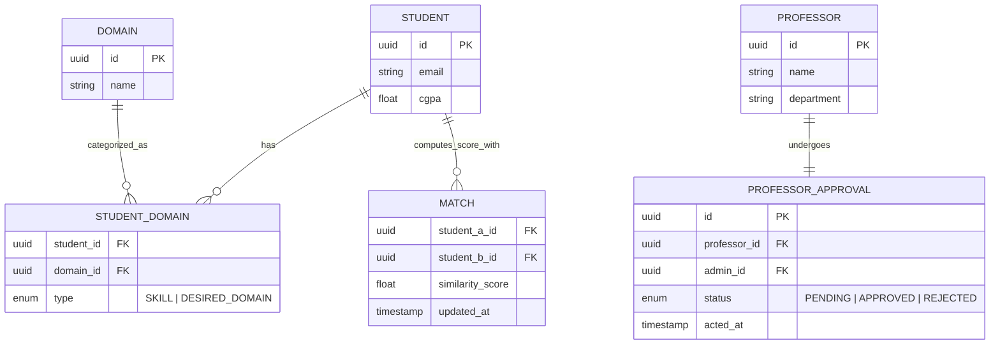

<div align="center">
  <h1>🤝 PartnerLink</h1>
  <h3>The Exclusive GIKI FYP Matchmaker</h3>
  <p>
    <b>Connect with peers. Discover faculty. Build the perfect Final Year Project group.</b>
  </p>
  
  <p>
    <a href="#-overview"></a>
    <a href="#-tech-stack"></a>
    <a href="#-system-architecture"></a>
  </p>
</div>

<hr/>

## 📖 Overview

**PartnerLink** is a specialized platform built exclusively for students and faculty at the **Ghulam Ishaq Khan Institute (GIKI)**. Developed as a comprehensive Software Engineering course project, its primary mission is to simplify and optimize the formation of Final Year Project (FYP) groups. 

By analyzing shared interests, technical skills, academic performance, and desired research domains, PartnerLink connects students with compatible peers and suitable professors, ensuring that every project starts with a strong, unified foundation.

---

## 👥 User Roles & Workflows

PartnerLink is designed with three distinct user journeys to maintain a secure and efficient ecosystem.

### 🎓 Student
- **Gated Registration:** Self-registers using a verified GIKI email address to ensure platform exclusivity.
- **Rich Profiles:** Builds a comprehensive profile detailing their CGPA, technical skills, interests, and preferred FYP research domains.
- **Discovery:** Browses a directory of available peers and vetted professors.
- **Smart Matching:** Views algorithmic recommendations tailored to maximize group synergy and project success.

### 👨‍🏫 Professor
- **Self-Onboarding:** Registers with their name, associated department, and specialized research domains.
- **Vetted Entry:** Placed in a pending state upon registration until verified by an Administrator, ensuring only legitimate faculty are accessible to students.

### 🛡️ Admin (Moderator)
- **Quality Control:** Reviews professor registrations in a dedicated approval panel.
- **Audit Logging:** Approves or rejects faculty requests, maintaining platform integrity and a clear audit trail.

---

## ✨ Core Features

* 🔒 **Secure, Domain-Restricted Registration:** Platform access is strictly limited to GIKI constituents.
* 📊 **Comprehensive Skill Mapping:** Profiles capture both current capabilities and future research ambitions.
* 🧠 **Intelligent Recommendation Engine:** A dynamic, ranked matching algorithm based on holistic student metrics.
* ✅ **Admin Approval Workflow:** Secure faculty onboarding backed by comprehensive audit trails.
* 🔍 **Advanced Directory Filtering:** Easily browse and filter the directory for approved students and professors based on domains and skills.

---

## 🏗️ System Architecture & Database Design

PartnerLink's architecture is driven by performance, traceability, and scalable relationship mapping. Below are the key architectural decisions:

### 1. Unified Domain Mapping
To efficiently manage the complex relationships between students, their existing skills, and their desired research domains, we implemented a **`STUDENT_DOMAIN` junction table**. 
- It utilizes a `type` enum (e.g., `SKILL` vs. `DESIRED_DOMAIN`) to distinguish between what a student already knows and what they want to pursue, streamlining queries and reducing schema bloat.

### 2. Precomputed Matches
Calculating similarity scores between every pair of students in real-time is computationally expensive. 
- We introduced a **`MATCH` table** that caches precomputed similarity scores. 
- A background worker periodically updates these scores, enabling instant page loads and immediate recommendations for users.

### 3. Audit-Driven Approvals
Instead of a simple boolean flag (`is_approved`) for professor accounts, we designed a dedicated **`PROFESSOR_APPROVAL` table**.
- This tracks the entire approval lifecycle: *Who* approved it, *When* it was approved, and the current *Status* (Pending, Approved, Rejected). 
- This guarantees strict auditability and better traceability for platform moderators.

#### Simplified Entity-Relationship Diagram (ERD)



---

## 🧬 Matching Algorithm

The core of PartnerLink's recommendation engine is a **Ranked Matching Algorithm** designed to evaluate compatibility across multiple dimensions:

1. **Skill & Interest Overlap:** Calculates the Jaccard similarity between students' existing technical skills and desired FYP domains.
2. **Academic Compatibility:** Considers the CGPA variance to group students with similar academic goals and working habits.
3. **Domain Alignment:** Prioritizes matches where students share identical primary research domains.

The final output is a weighted composite score (cached in the `MATCH` table) that dictates the rank of recommended peers on the student dashboard.

---

## 🛠️ Tech Stack

> **Note:** Fill in the technologies used for your project here.

- **Frontend:** e.g., React, Next.js, Tailwind CSS
- **Backend:** e.g., Node.js, Express, Python FastAPI, Spring Boot
- **Database:** e.g., PostgreSQL, MySQL, MongoDB
- **Deployment:** e.g., Docker, AWS, Vercel

---

## 🚀 Installation & Run Instructions

To run this project locally, follow these steps:

### Prerequisites
- Node.js (v18+)
- Database Engine (e.g., PostgreSQL)

### Setup

1. **Clone the repository**
   ```bash
   git clone https://github.com/your-username/PartnerLink.git
   cd PartnerLink
   ```

2. **Install dependencies**
   ```bash
   # For backend
   cd backend && npm install
   
   # For frontend
   cd ../frontend && npm install
   ```

3. **Run the development servers**
   ```bash
   # Backend
   npm run dev
   
   # Frontend
   npm start
   ```

---

## 🔐 Environment Variables

Create a `.env` file in the root directory and configure the following variables:

```env
# Database Configuration
DATABASE_URL="your_database_connection_string"

# Authentication Secrets
JWT_SECRET="your_jwt_secret_key"
OAUTH_CLIENT_ID="giki_oauth_client_id"

# App Settings
PORT=8000
NODE_ENV="development"
```

<hr/>

<div align="center">
  <i>Developed with ❤️ for the GIKI Software Engineering Course.</i>
</div>
